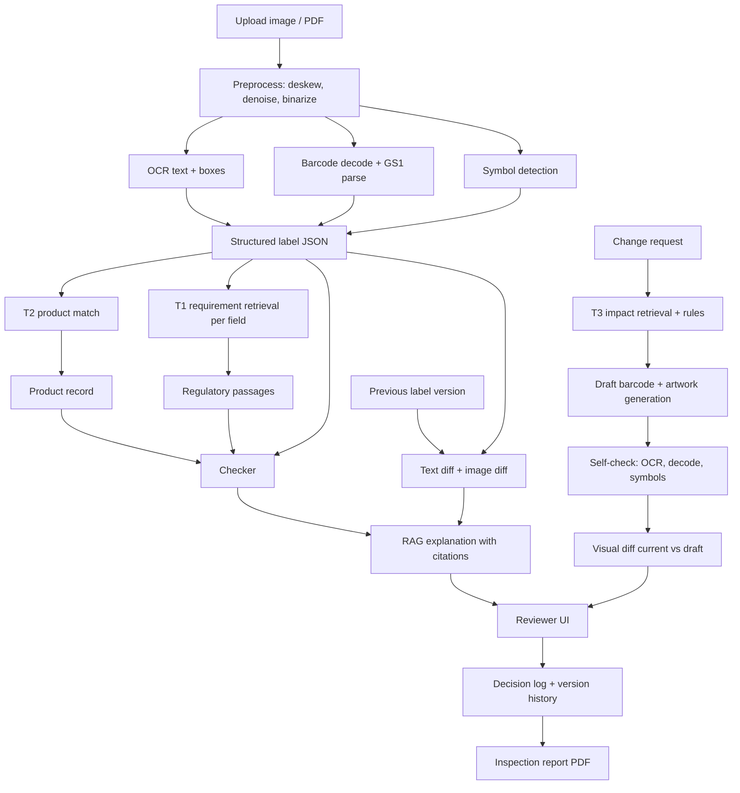

# Workflow

## A. System pipeline



## B. Corpus pipeline (crawling and tracking)

1. Crawl: openFDA device and drug label endpoints, DailyMed SPL, GUDID, FDA labeling guidance, EU MDR labeling annexes, ISO 15223-1 symbol list, GS1 UDI docs.
2. Clean and chunk: split by section or clause, keep source URL, title, section id, fetch date.
3. Hash each chunk. On re-crawl, a changed hash means a new version: store both and flag the diff.
4. Index: BM25 inverted index and dense FAISS index, rebuilt incrementally.

Chunk schema:

```json
{"chunk_id":"fda_21cfr801_s109_c3","source":"FDA","url":"...","title":"...","section":"801.109","text":"...","fetched":"2026-11-09","hash":"..."}
```

## C. Label extraction schema

```json
{"label_id":"...","version":2,
 "fields":{"product_name":"","model":"","manufacturer":"","udi_di":"","lot":"","expiry":"","storage":"","warnings":[],"rx_only":true},
 "barcodes":[{"type":"GS1-128","raw":"","parsed":{}}],
 "symbols":[{"name":"sterile","iso":"5.2.x","bbox":[0,0,0,0],"conf":0.0}],
 "ocr_blocks":[{"text":"","bbox":[0,0,0,0],"conf":0.0}]}
```

## D. Checks the system runs

| Check | Source of truth | Output |
|---|---|---|
| Field vs record | Product DB | mismatch with both values |
| Barcode vs printed text | GS1 parse | mismatch |
| Required symbol present | Requirement retrieval + ISO list | missing symbol |
| Required warning present | Requirement retrieval | missing or weak match |
| Expiry or date format | Rules | format issue |
| Revision diff | Previous version | changed fields and regions |

Each flag carries: severity, evidence passages (with source link), confidence, suggested action. Weak evidence means the system says "needs human review" instead of guessing.

## E. Build plan

The 10 day parallel plan, gates, version ladder and risks live in `docs/PLAN_10_DAYS.md`. Checklist in `docs/TASKS.md`.

Rule: IR evaluation starts on Day 3 and never stops. Every later feature must show a number.

## F. Day to day dev workflow

1. One GitHub issue per task, labelled by phase and owner.
2. Branch per task: `feat/<area>-<short-name>`.
3. The Antigravity agent works from the prompt in `docs/ANTIGRAVITY_PROMPTS.md` and the rules in `AGENTS.md`.
4. A human reviews the diff, runs tests, and runs the eval command if retrieval changed.
5. A PR needs one teammate review and a metrics line in the description if it touches IR, CV or RAG.
6. Merge to `main` only when tests pass. Tag a release at the end of each phase.
7. Weekly 30 minute sync: show the results table, decide the next cut.

## G. Risk and fallback

| Risk | Fallback |
|---|---|
| Symbol detection weak | Template matching plus classifier on cropped candidates |
| OCR poor on photos | Report scans and photos separately, be honest |
| No real labels | Synthetic labels plus public DailyMed labels |
| Crawl blocked | Official APIs and cached snapshots in `data/raw` |
| LLM hallucination | Citation check, abstain rule, show passages first |
| Time | Drop patient interface, keep T1 to T3 plus eval |
