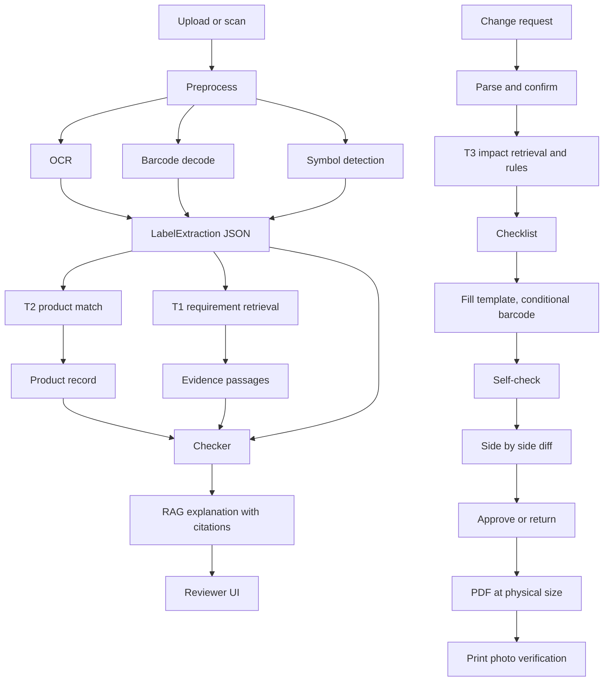

# Workflow

## A. System pipeline

## B. Corpus pipeline
1. Crawl eCFR (21 CFR 801, 803, 806, 807, 809, 812, 820, 830 for devices, 201, 208, 211 for medicine). Later openFDA, FDA guidance, EU MDR labeling annex.
2. Chunk by section, about 200 words with 25 overlap, skip sections under 5 words, content hash per chunk.
3. On re-crawl, a changed hash means a new version, store both and flag the diff.
4. Index: own BM25 index and dense FAISS index (embedding cache keyed by chunk id and hash). Filter by `module` (device or medicine) before ranking.

## C. Schemas
Defined in `src/common/schemas.py` (locked): Chunk, Hit, OcrBlock, BarcodeResult, SymbolDetection, LabelExtraction, ProductRecord, Flag, ChangeRequest, IdentifierRequired. Template spec is in `docs/GENERATION.md` and is added to schemas on Day 5 by Pari.

## D. Checks the system runs

| Check | Source of truth | Output |
|---|---|---|
| Field vs record | Product record | mismatch with both values |
| Barcode vs printed text | GS1 parse | mismatch |
| Required symbol present | Retrieval and symbol registry | missing symbol |
| Required warning present | Retrieval | missing or weak match |
| Date format | Rules | format issue |
| Revision diff | Previous version | changed fields and regions |
| Layout (generated) | Template spec | overflow, clipping, size |
| Print vs approved | Approved revision | mismatch or unclear scan |

Each flag carries severity, evidence passages with source link, confidence, suggested action.

## E. Plan
Day plan, gates and ownership live in `docs/TEAM_PLAN.md`. Task checklist in `docs/TASKS.md`.

## F. Dev workflow
1. One branch per task, named `feat/<area>-<short-name>`, pull request into `main`, Pari reviews.
2. Claude Code with the repo `CLAUDE.md`. Plan mode first, approve, then build.
3. A pull request touching IR, CV or RAG states the metric that changed and the command that produced it.
4. Tests and lint must pass. CI must be green.
5. Every number in the report comes from a rerunnable command.

## G. Risks and fallbacks

| Risk | Fallback |
|---|---|
| Template from arbitrary artwork | Semi-manual slot marking, one template family |
| Symbol detection weak | Template matching on a handful of symbols |
| OCR poor on photos | Report scan and photo separately |
| No real labels | Synthetic labels plus public DailyMed labels |
| Crawl blocked | Cached snapshots in `data/raw` |
| LLM hallucination | Citation check, abstain rule |
| Time | Shrink public mode, keep IR, change flow and generation |
